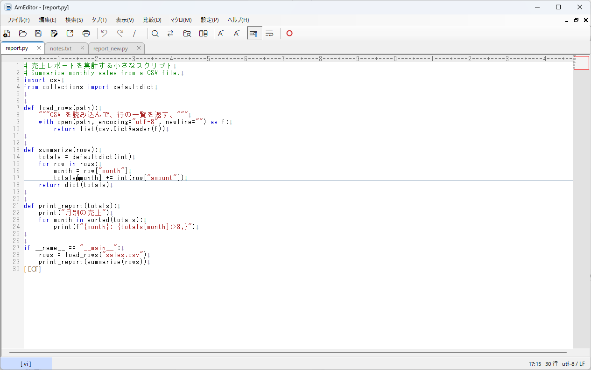
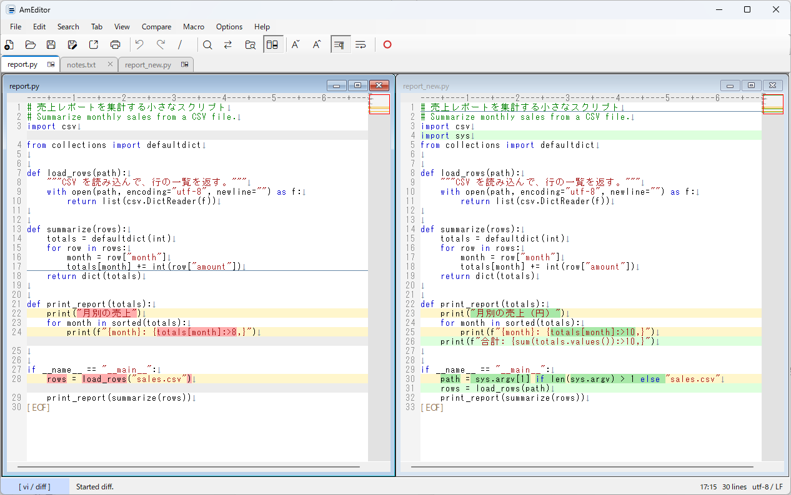
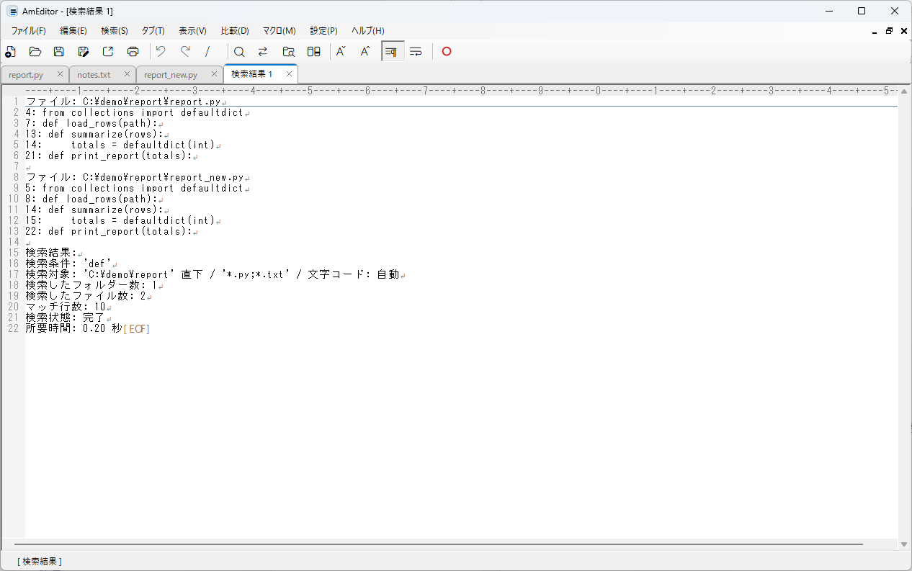

# AmEditor

*English: AmEditor is a free text editor for Windows 11 with optional vi-style editing. See the [English summary](#english-summary) below.*

AmEditor ( アムエディタ ) は、Windows 11 向けのテキストエディターです。ふだんの Windows の編集操作に、vi の操作を重ねて使えます。大きなテキストファイルや、複数の文書を並べての作業が得意です。

**[最新版をダウンロード](https://github.com/amnesia828-coder/AmEditor-Release/releases/latest)**　｜　[更新履歴](https://github.com/amnesia828-coder/AmEditor-Release/releases)　｜　[不具合の報告・要望](https://github.com/amnesia828-coder/AmEditor-Release/issues)

## 主な機能

- 通常の編集と vi の操作 ( 移動、ビジュアル選択、`:` コマンド、検索・置換 ) を切り替えて使える
- GB 級の大きなテキストファイルを開いて、検索・置換できる
- タブと文書ウィンドウ ( MDI ) 、タブ同士の比較 ( diff ) 。比較したまま編集できる
- 文字・行・矩形の選択、元に戻す／やり直し、自動インデント
- 文字コード・BOM・改行コードの指定、外部での変更の検知、自動バックアップ
- 構文の色分け、grep、印刷、選択範囲の16進表示
- 折り返し、行番号、ルーラー、行末記号・全角空白・タブの表示、ブロックの折りたたみ
- `.aem` マクロの実行と録画
- 表示言語は日本語と英語

### 画面の例

**タブ同士の比較 ( diff )**：2つのタブを左右に並べて、追加・変更した行を色で示します。比較したまま、どちらも編集できます。 ( 画像は英語表示の例です )

**ファイル横断検索 ( grep )**：フォルダーの中のファイルを探し、結果の行から、その場所へ移動できます。

## vi を知らない方へ

vi の操作を知らなくても、そのまま使えます。起動すると、メモ帳と同じ感覚で打てる普通のエディターです。vi の操作は、使いたい人が、必要なときだけ重ねて使うものです。

試してみたい方のために、最初の一歩を書きます。

- **vi の操作に入る**：`Esc` を押します。画面の左下に、いまのモード ( 通常／vi ) が出ます。vi の操作中は、文字は入力されません。
- **普通の入力に戻る**：`i` を押します ( カーソルの位置から入力できます ) 。
- **動く**：`h` 左、`j` 下、`k` 上、`l` 右。単語単位は `w` ( 次 ) と `b` ( 前 ) 、行頭は `0`、行末は `$`。
- **直す**：`x` で1文字削除、`dd` で1行削除、`yy` で1行コピー、`p` で貼り付け、`u` で取り消し。
- **保存して閉じる**：`:w` で保存、`:q` で閉じる、`:wq` で保存して閉じる。

もっと知りたいときは、メニューの「ヘルプ」→「使い方ヘルプ」を開いてください。練習用の行が付いた文書が開くので、実際にキーを試せます。

## 動作環境

- Windows 11 ( x64 )
- AmEditor は .NET ランタイムを含めて配布しています。別途インストールする必要はありません。

## インストールと更新

1. [最新版のページ](https://github.com/amnesia828-coder/AmEditor-Release/releases/latest)の **Assets** から `AmEditor-Setup-<版>.exe` をダウンロードします。
2. ダウンロードしたファイルを実行します。管理者権限は要りません ( 利用者ごとにインストールします ) 。

更新するときも、新しいインストーラーを実行するだけです。設定 ( `config.amset` ) と履歴、自分で編集したブロック・コメント・マクロの定義は、そのまま残ります。

> **「Windows によって PC が保護されました」と出たとき**
> インストーラーにはコード署名をしていないため、Windows の SmartScreen がこの画面を出すことがあります。「詳細情報」を押し、「実行」を選ぶと続けられます。心配なときは、リリースのページにある SHA-256 の値と、ダウンロードしたファイルの値 ( PowerShell で `Get-FileHash <ファイル>` ) が一致するかを確かめてください。

アンインストールは、Windows の「設定」→「アプリ」から行えます。

## よくある質問

**vi を知らなくても使えますか。**
使えます。上の「vi を知らない方へ」をご覧ください。

**管理者権限は要りますか。**
要りません。利用者ごとにインストールします。

**会社の PC に入れてもよいですか。台数に制限はありますか。**
個人でも仕事でも、無料で使えます。台数の制限もありません。ただし、会社や学校など、それぞれの組織の規則は守ってください。組織の中で配る場合の条件は、[利用規約の第4条](TERMS.md#4-配布)をご覧ください。

**AmEditor は、インターネットに通信しますか。**
AmEditor 自体には、通信する機能はありません。文章中の URL を `Ctrl` を押しながらクリックしたときだけ、既定のブラウザー ( またはメールソフト ) を起動します。更新の確認も自動では行いません。新しい版は、このページの最新版から入手してください。

**設定はどこで変えますか。表示言語を英語に ( 日本語に ) したいのですが。**
メニューの「設定」→「環境設定」です。表示言語は、「外観」の先頭にあります。変更は、AmEditor を起動し直したあとに反映されます。初期値は、OS の言語に従います。

**インストールのときに「Windows によって PC が保護されました」と出ました。**
「[インストールと更新](#インストールと更新)」の注意書きをご覧ください。

**不具合を見つけました。要望があります。**
次の「不具合の報告・要望」から、お知らせください。

## 不具合の報告・要望

[Issues](https://github.com/amnesia828-coder/AmEditor-Release/issues) で受け付けています。「New issue」から、「不具合の報告」か「機能の要望」を選んでください。投稿には GitHub のアカウントが必要です。

報告の前に、同じ内容がすでに挙がっていないか、Issues の一覧で探してみてください。

GitHub のアカウントがない場合は、メール ( freewaresupport@amnesia.to ) でも連絡できます。返信が迷惑メールのフォルダーに入ることがあるので、`@amnesia.to` からのメールを受信できるようにしておいてください。

## 作者への応援

応援の位置づけ、方法、送付先は[利用規約の第3条](TERMS.md#3-作者への応援)をご覧ください。

## このリポジトリについて

このリポジトリは、AmEditor の配布と、利用者からの報告の受付のためのものです。ソースコードはここにはありません。

作者の note：https://note.com/amnesia828 ( AmEditor の紹介や、作った話を書いています )

## English summary

**AmEditor** is a text editor for Windows 11 (x64). It works like Notepad out of the box, and you can layer vi-style editing (movement, visual selection, `:` commands, search and replace) on top whenever you want it. It opens very large text files (GB class), compares tabs side by side, and supports syntax highlighting, grep, macros and printing. The UI is available in Japanese and English.

- **Download:** [Latest release](https://github.com/amnesia828-coder/AmEditor-Release/releases/latest) → get `AmEditor-Setup-<version>.exe` from **Assets**.
- **Requirements:** Windows 11 (x64). The .NET runtime is included with AmEditor, so you do not need to install it separately. No administrator rights are needed; it installs per user. To update, run the new installer.
- **If Windows SmartScreen says "Windows protected your PC":** the installer is not code-signed. Click "More info", then "Run anyway". To verify the download, compare the SHA-256 value shown on the release page with the output of `Get-FileHash <file>` in PowerShell.
- **Terms:** Free for individuals and organizations, personal or commercial use, with no limit on installations. Please do not redistribute modified copies, and distribute only through this page (redistribution inside your own organization is allowed under conditions). The software is provided "as is" without warranty. The Japanese text of the [Terms of Use](TERMS.md) is authoritative; an [English reference translation](TERMS.en.md) is provided and is not legally binding.
- **English UI:** the English screens were translated by the author and have **not** been reviewed by a native English speaker. If you find something odd, please let us know.
- **Bug reports and requests:** please use [Issues](https://github.com/amnesia828-coder/AmEditor-Release/issues) (a GitHub account is required). Both Japanese and English are welcome; replies are mainly in Japanese, with short English where possible. No response or fix is guaranteed. Without a GitHub account you can write to freewaresupport@amnesia.to. Replies may land in your spam folder, so please allow mail from `@amnesia.to`.
- **Support the author (optional):** if you like AmEditor, you can send an Amazon.co.jp eGift Card (these are country-specific and may not be available outside Japan; there is no need to send anything); it is a voluntary gift, not payment, and does not change features or support. See [Terms, Article 3](TERMS.en.md#3-supporting-the-author).

## 利用規約

利用条件は[利用規約](TERMS.md)をご確認ください ( [英語の参考訳](TERMS.en.md) ) 。

© 2026 amnesia828

同梱ソフトと適用ライセンスは[利用規約の第7条](TERMS.md#7-本ソフトに含まれる他者のソフトウェア)をご覧ください。
